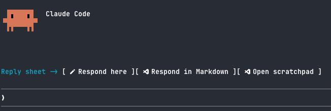

# reply-sheet



A Claude Code plugin for replying to long Claude answers item by item, instead of in one prompt.

When Claude gives you review findings, a results table or a list of questions, click **Respond here**. Haiku turns Claude's last answer into a reply file with a `Response:` box under each item. You fill in the boxes you care about and press **Submit**. Claude gets back only the items you answered.

## What you get

A row above the prompt:

```
Reply sheet -> [Respond here] [Respond in Markdown] [Open scratchpad]
```

- **Respond here** opens a pane next to the chat. Each item is shown with its own answer box. The boxes grow as you type.
- **Respond in Markdown** opens the same reply file (`response.md`) in VS Code.
- **Open scratchpad** opens the session's scratchpad folder in VS Code.
- **Submit response**, **Save** and **Close pane** show up while a reply is in progress.

Commands:

| Command | Does |
|---|---|
| `/reply` | Build (if needed) and open `response.md` in VS Code |
| `/reply submit` | Send your answers to Claude |
| `/scratchpad` | Open the scratchpad folder |

## How it works

1. **Building the file.** The plugin reads Claude's latest turn, plus any `.md` file Claude wrote in that turn. It sends that text to Haiku in a side call: it is not added to the conversation and does not use the session's model.
2. **Layout.** Each section becomes one item. Each table row becomes its own item with one bullet per column. Each question becomes its own `Q1.`, `Q2.` item. A `## Other comments` section comes last.
3. **Check.** The plugin compares Haiku's file with Claude's answer line by line. If Haiku left something out, a yellow warning names the missing line.
4. **Submit.** The plugin sends only the items you answered, each as its heading plus your answer, plus your other comments. Unanswered items are not sent, because Claude already has them in context. The full file is kept as `response-<time>.md` in the scratchpad, and its path is in the message.

The reply file lives in the session's scratchpad folder. The plugin finds it by looking for `<session id>/scratchpad` under the temp folders Claude Code uses. If it can't find it, it uses `~/.claude/reply-sheet/<session id>/` and says so.

## Install

Needs Claude Code 2.1.275 or later. The repo is a plugin marketplace, so it installs in one line.

At the prompt of a Claude Code session:

```
/plugin install reply-sheet --marketplace joshwright10/claude-code-reply-sheet
```

Or from a shell:

```sh
claude plugin install reply-sheet --marketplace joshwright10/claude-code-reply-sheet
```

What you'll see:

1. `Add marketplace?` naming `github:joshwright10/claude-code-reply-sheet`. Answer `y`.
2. The plugin's details and a scope. Pick **user** (the first one) to have it in every session.
3. The **Button icons** setting. Keep `on` if your terminal font is a Nerd Font (see [Getting the icons to show](#getting-the-icons-to-show)).
4. `Installed reply-sheet. Plugin is now active.` The **Reply sheet** row shows up above the prompt straight away.

In the desktop app, where `/plugin` does not run: click **+** next to the prompt box, then **Plugins**, **Add marketplace** with `joshwright10/claude-code-reply-sheet`, then **Add plugin**.

**Private repo.** While the repo is private, the install only works for people who can read it on GitHub and whose machine already has a git login for github.com (an SSH key, or `gh auth login` then `gh auth setup-git`). The install never asks for one.

### Update

```sh
claude plugin update reply-sheet
```

Then restart Claude Code. Releases are listed on the [Releases page](https://github.com/joshwright10/claude-code-reply-sheet/releases).

### Uninstall

```sh
claude plugin uninstall reply-sheet
```

## Settings

Change settings in Claude Code's `/config` menu. A change applies straight away.

| Setting | Values | Effect |
|---|---|---|
| Button icons (`icons`) | `on` (default) | Nerd Font icons on the buttons. Needs a Nerd Font as the terminal font (see below), or the icons show as empty boxes. |
| | `auto` | Icons only in Ghostty and WezTerm, which ship the icons; plain text elsewhere. |
| | `off` | Plain text buttons. |

The value is stored in `~/.claude/settings.json`:

```json
{
  "pluginConfigs": {
    "reply-sheet": { "options": { "icons": "off" } }
  }
}
```

### Getting the icons to show

The icons come from a [Nerd Font](https://www.nerdfonts.com/). Ghostty and WezTerm ship one built in, so they need no setup. Every other terminal needs a Nerd Font installed and chosen as its font. The steps below use JetBrains Mono; any Nerd Font works.

If you see empty boxes on the buttons, your terminal font has no Nerd Font icons. Follow the steps for your system, or set **Button icons** to `auto` or `off` in `/config`.

#### macOS

1. Install the font:

   ```sh
   brew install --cask font-jetbrains-mono-nerd-font
   ```

2. Choose it in your terminal:
   - **Warp:** Settings > Appearance > Text > Terminal font > **JetBrainsMono Nerd Font**. Or in `~/.warp/settings.toml`:

     ```toml
     [appearance.text]
     font_name = "JetBrainsMono Nerd Font"
     ```

   - **iTerm2:** Settings > Profiles > Text > Font > **JetBrainsMono Nerd Font**.
   - **Terminal.app:** Settings > Profiles > Text > Font > Change > **JetBrainsMono Nerd Font**.

#### Windows

1. Install the font, with [Scoop](https://scoop.sh/):

   ```powershell
   scoop bucket add nerd-fonts
   scoop install JetBrainsMono-NF
   ```

   Or download `JetBrainsMono.zip` from the [Nerd Fonts downloads page](https://www.nerdfonts.com/font-downloads), unzip it, select the `.ttf` files, right-click and choose **Install for all users**.

2. Choose it in your terminal:
   - **Windows Terminal:** Settings > Profiles > Defaults > Appearance > Font face > **JetBrainsMono Nerd Font**. Or in Windows Terminal's `settings.json`:

     ```json
     "profiles": { "defaults": { "font": { "face": "JetBrainsMono Nerd Font" } } }
     ```

   - **Warp:** Settings > Appearance > Text > Terminal font > **JetBrainsMono Nerd Font**.

3. Restart the terminal so it sees the new font.

#### Linux

1. Install the font for your user:

   ```sh
   mkdir -p ~/.local/share/fonts/JetBrainsMono
   curl -fLo /tmp/JetBrainsMono.zip https://github.com/ryanoasis/nerd-fonts/releases/latest/download/JetBrainsMono.zip
   unzip -o /tmp/JetBrainsMono.zip -d ~/.local/share/fonts/JetBrainsMono
   fc-cache -f
   ```

   Many distributions also package it, for example `ttf-jetbrains-mono-nerd` on Arch.

2. Choose it in your terminal:
   - **GNOME Terminal:** Preferences > your profile > Text > Custom font > **JetBrainsMono Nerd Font**.
   - **Konsole:** Settings > Edit Current Profile > Appearance > Font > **JetBrainsMono Nerd Font**.
   - **Kitty:** add `font_family JetBrainsMono Nerd Font` to `~/.config/kitty/kitty.conf`.
   - **Alacritty:** in `~/.config/alacritty/alacritty.toml`:

     ```toml
     [font.normal]
     family = "JetBrainsMono Nerd Font"
     ```

   - **Warp:** Settings > Appearance > Text > Terminal font > **JetBrainsMono Nerd Font**.

3. Run `fc-list | grep -i "JetBrainsMono Nerd"` to check the font is installed if it doesn't show up in the list.

## Platform notes

- **Opening files.** macOS: VS Code's own CLI, then `code`, then `open -a "Visual Studio Code"`, then the default app. Windows: `code` on the PATH, then `Code.exe` in the usual install folders, then Explorer. Linux: `code`, then `xdg-open`.
- **Windows is untested.**
- **The pane** opens beside the chat only in a wide terminal (about 110 to 144 columns). In a narrower one it opens below the chat.

## Known limits

- The pane's text boxes are Claude Code's own. Clicking does not move the cursor to the click; use the arrow keys, or VS Code for bigger edits.
- Plugins cannot add Ctrl or Cmd shortcuts, so there is no keyboard shortcut for Submit while typing in a box.
- Haiku's layout varies a little between runs. The missing-line check catches dropped content, not reworded content.
- Finding the scratchpad depends on Claude Code's temp folder layout, which is not a public API.

## Contributing

See [AGENTS.md](AGENTS.md) for the layout, how to run it from a clone, tests and releases.
